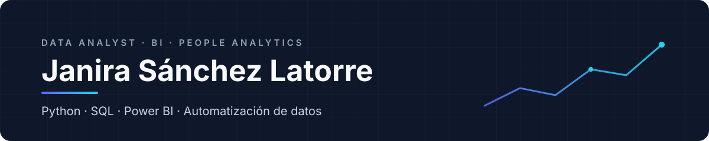

  

  <a href="https://www.linkedin.com/in/janira-sanchez-latorre-"><b>LinkedIn</b></a>
  &nbsp;&nbsp;·&nbsp;&nbsp;
  <a href="mailto:janira9345@gmail.com"><b>janira9345@gmail.com</b></a>
  &nbsp;&nbsp;·&nbsp;&nbsp;
  Alicante · Remoto

 

Convierto datos en decisiones. Antes de dedicarme al análisis gestioné la barra de tres restaurantes con un equipo de doce personas: sé cómo funciona un negocio por dentro y qué indicadores importan de verdad. Hoy combino esa visión con Python, SQL y Power BI, y me gusta llevar los datos hasta el final: un pipeline que se ejecuta solo cada mañana o un producto en producción.

<table>
  <tr>
    <td width="33%" valign="top">FORMACIÓN <b>Data Analytics &amp; AI</b> Adalab  <b>Marketing Digital y E-commerce</b> EAE Business School</td>
    <td width="33%" valign="top">EXPERIENCIA <b>Gestión de equipos y operaciones</b> Tres restaurantes, doce personas a cargo</td>
    <td width="33%" valign="top">BUSCO <b>Data Analyst · BI Analyst · People Analytics</b> Alicante, híbrido o remoto</td>
  </tr>
</table>

 

## Proyectos de datos

<table>
  <tr>
    <td width="50%" valign="top">
      <h3><a href="https://github.com/janirasl/job-hunter-ai">Job Hunter AI</a></h3>
      PROYECTO INDIVIDUAL · PIPELINE ETL
      
Automatiza mi búsqueda de empleo. Cada mañana capta ofertas de tres APIs, las filtra por nivel, ubicación y modalidad, las puntúa de 0 a 100 según encaje con mi perfil, elimina duplicados entre fuentes y guarda las nuevas en Notion. Empezó como un flujo en n8n y lo migré a Python.

      <b>Python</b> · GitHub Actions · APIs REST · Notion API · pytest
      
<a href="https://github.com/janirasl/job-hunter-ai">Ver repositorio →</a>

    </td>
    <td width="50%" valign="top">
      <h3>Rentabilidad del alquiler en San Vicente del Raspeig</h3>
      PROYECTO INDIVIDUAL · EN CURSO
      
¿Qué estrategia maximiza la rentabilidad de un piso: alquiler residencial, por habitaciones, turístico o mixto? Integra Idealista, Fotocasa, Airbnb, Booking, el registro de viviendas turísticas y la bolsa de alojamiento de la Universidad de Alicante, con deduplicación entre portales y comparación de rentabilidad neta y ROI.

      <b>Python</b> · Pandas · Limpieza de datos · EDA · Análisis financiero
    </td>
  </tr>
  <tr>
    <td width="50%" valign="top">
      <h3>Festival Data Beats</h3>
      PROYECTO EN EQUIPO · ADALAB
      
Consultoría para una promotora de festivales: qué artistas españoles tienen más potencial para un cartel dirigido a millennials. Scraping de Last.fm, base de datos normalizada en SQL y presentación de resultados.

      <b>Python</b> · BeautifulSoup · SQLAlchemy · SQL
    </td>
    <td width="50%" valign="top">
      <h3>Precios y salud alimentaria</h3>
      PROYECTO EN EQUIPO · ADALAB
      
Dashboard en Tableau que cruza varias fuentes de datos sobre precios y salud alimentaria y las convierte en una historia visual.

      <b>Tableau</b> · EDA · Data Storytelling
    </td>
  </tr>
</table>

  
<b>Otros proyectos de Adalab</b>

   
  <b>Limpieza y análisis exploratorio</b> · en pareja — tratamiento de nulos, uniones, estadística descriptiva y EDA sobre datasets reales. Python · Pandas · NumPy
    
  <b>SQL avanzado</b> · en pareja — subconsultas, joins complejos y funciones de ventana. SQL · MySQL

 

## Productos propios

<table>
  <tr>
    <td width="50%" valign="top">
      <h3><a href="https://www.hitrivi.com">Trivi</a></h3>
      EN PRODUCCIÓN · CÓDIGO PRIVADO
      
Revista de viajes que recomienda destinos según cómo quieres sentirte: itinerarios curados, guías editoriales y una editora conversacional, con captura de leads y motor de recomendación propios.

      <b>Next.js</b> · React · FastAPI · Vercel
      
<a href="https://www.hitrivi.com">hitrivi.com →</a>

    </td>
    <td width="50%" valign="top">
      <h3><a href="https://radar-local-y3l8.onrender.com/">Radar Local</a></h3>
      EN DESARROLLO · CÓDIGO PRIVADO
      
Plataforma de datos pensada para inmobiliarias, para tomar decisiones con información del mercado local.

      <b>Python</b> · Render
      
<a href="https://radar-local-y3l8.onrender.com/">Ver Radar Local →</a>

    </td>
  </tr>
</table>

 

## Herramientas

<table>
  <tr>
    <td width="25%" valign="top">ANÁLISIS Python Pandas NumPy Jupyter</td>
    <td width="25%" valign="top">DATOS SQL · MySQL SQLAlchemy BeautifulSoup APIs REST</td>
    <td width="25%" valign="top">VISUALIZACIÓN Power BI Tableau Data Storytelling</td>
    <td width="25%" valign="top">AUTOMATIZACIÓN GitHub Actions n8n Notion API Git</td>
  </tr>
</table>

 

Ahora mismo: construyendo el dashboard de Power BI de Job Hunter AI y terminando el análisis de rentabilidad del alquiler.

